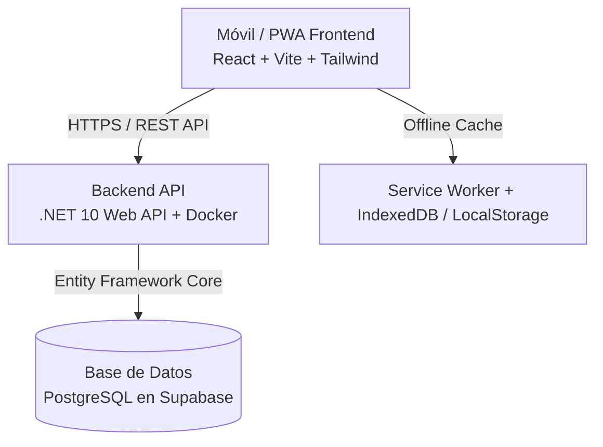

# 🏋️‍♂️ MetrikGym - Progressive Overload & Workout Tracking PWA


**MetrikGym** es una aplicación web progresiva (PWA) de alto rendimiento diseñada específicamente para atletas y practicantes de sobrecarga progresiva en el gimnasio. Permite registrar entrenamientos en tiempo real, visualizar cargas previas por ejercicio, controlar descansos con temporizador inteligente y sincronizar sesiones tanto online como offline.

---

## 🚀 Arquitectura y Tecnologías



### 📱 Frontend (Web / PWA)
- **Framework:** React 18 + TypeScript + Vite.
- **Estilos:** Tailwind CSS con tema Dark Gym Athletic (`#0B0F17`, acentos esmeralda/cian).
- **Iconografía:** Lucide React + Favicons vectoriales y PNG nativos PWA (192x192, 512x512).
- **Capacidades Offline:** Service Worker registrado (`sw.js`), cola de sincronización resiliente ante pérdidas de conectividad.
- **Audio y Notificaciones:** Web Audio API sintético para alertas de fin de descanso y Web Notifications API con soporte de vibración en pantalla bloqueada.
- **Hosting:** [Vercel](https://vercel.com) (Despliegue continuo con SPA rewrites).

### ⚙️ Backend (API REST)
- **Framework:** ASP.NET Core (.NET 10).
- **Arquitectura:** Clean Architecture con separación estricta en capas:
  - `MetrikGym.Domain`: Entidades del dominio, reglas de negocio y agregados.
  - `MetrikGym.Application`: DTOs, interfaces de servicios y casos de uso.
  - `MetrikGym.Infrastructure`: Implementaciones de persistencia EF Core, BCrypt Enhanced y tokens JWT.
  - `MetrikGym.Api`: Controladores REST, middleware de autenticación, CORS y endpoints de health check (`/healthz`).
- **Autenticación:** JWT Bearer tokens + BCrypt Enhanced (WorkFactor 11) para hashing seguro.
- **Contenedor:** Docker multi-etapa optimizado en Alpine/Debian con compatibilidad Kerberos/SSL para Npgsql.
- **Hosting:** [Render.com](https://render.com) (Web Service en Docker).

### 🗄️ Base de Datos
- **Motor:** PostgreSQL (alojado en Supabase con Session Pooler).
- **ORM:** Entity Framework Core con migraciones automáticas (`dotnet ef database update`).
- **Tablas Principales:**
  - `Usuarios`: Perfiles de usuario y administradores.
  - `Ejercicios`: Catálogo maestro de 80 ejercicios clasificados por grupo muscular y unilateralidad.
  - `Rutinas`: Rutinas personalizadas por usuario con días sugeridos.
  - `RutinaEjercicios`: Mapeo de ejercicios ordenados por rutina con series objetivo y descansos.
  - `SesionesEntrenamiento`: Historial de entrenamientos iniciados, finalizados y notas.
  - `SeriesRegistro`: Registro granular de cada serie (peso en kg, repeticiones, RPE, lateralidad).

---

## 🌟 Características Principales

1. **Modo Libre vs. Rutina Programada:** Inicia una rutina predefinida o crea una sesión libre en cualquier momento.
2. **Historial al Vuelo:** Visualiza automáticamente la última carga (kg) y repeticiones registradas para cada ejercicio durante el entrenamiento.
3. **Temporizador Inteligente:** Contador regresivo automático entre series con alertas acústicas y visuales.
4. **Calculadora de Placas:** Desglose visual de discos en barra olímpica estándar (20 kg) o barra Z.
5. **Panel de Métricas y Estadísticas:** Análisis de volumen total (kg levantados), consistencia semanal y distribución muscular.
6. **PWA Instalable:** Instalación con un clic en dispositivos iOS y Android, funcionando a pantalla completa como una aplicación nativa.

---

## 🛠️ Ejecución Local

### Prerrequisitos
- [.NET 10 SDK](https://dotnet.microsoft.com/)
- [Node.js 20+](https://nodejs.org/)
- [PostgreSQL](https://www.postgresql.org/) o instancia activa de Supabase

### 1. Clonar el repositorio
```bash
git clone https://github.com/ManuelQuiroga03/metrikGym.git
cd metrikGym
```

### 2. Configurar el Backend
Edita `src/MetrikGym.Api/appsettings.json` o define la variable de entorno `ConnectionStrings__PostgresConnection`:
```bash
dotnet restore
dotnet run --project src/MetrikGym.Api
```
El backend estará disponible en `http://localhost:5002` o `https://localhost:7002`.

### 3. Configurar el Frontend
```bash
cd src/MetrikGym.Web
npm install
npm run dev
```
La aplicación web estará disponible en `http://localhost:5173`.

---

## 🚢 Despliegue en Producción

| Componente | Plataforma | URL Productiva |
| :--- | :--- | :--- |
| **API Backend** | Render (Docker) | `https://metrikgym.onrender.com` |
| **Frontend PWA** | Vercel | `https://metrik-gym.vercel.app` |
| **Base de Datos** | Supabase PostgreSQL | `aws-0-us-east-2.pooler.supabase.com:5432` |

---

## 📄 Licencia

Este proyecto es de uso personal y privado desarrollado para **Milo** (MetrikGym).
